# I've seen it all — 20 free video effects for Claude

Drop your clip into Claude, say the effect and the seconds. That's the whole edit. Works on Mac and Windows.

By **Raed Ouerfelli**.

## The 20 effects
<table>
<tr><td align="center" width="25%">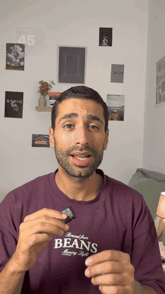<br><code>glass-widgets</code><br><sub>frosted glass widgets around your head</sub></td><td align="center" width="25%">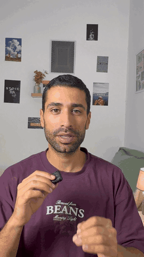<br><code>orbit</code><br><sub>your reels circle your head</sub></td><td align="center" width="25%">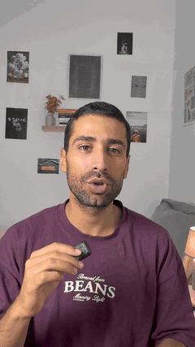<br><code>spotlight</code><br><sub>lights drop, glowing word behind you</sub></td><td align="center" width="25%">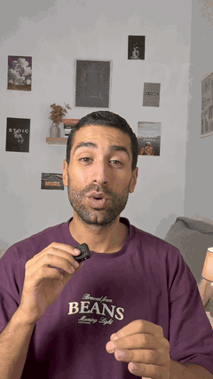<br><code>glitter-spotlight</code><br><sub>spotlight look: gold rays, gold word, sparkles</sub></td></tr>
<tr><td align="center" width="25%">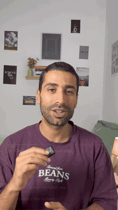<br><code>checklist</code><br><sub>Claude task list ticks green</sub></td><td align="center" width="25%">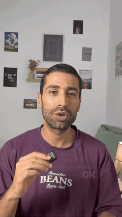<br><code>liquid-glass-graph</code><br><sub>glass card, graph climbs</sub></td><td align="center" width="25%">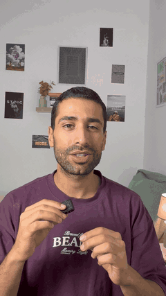<br><code>liquid-glass-graph (bento)</code><br><sub>liquid-glass-graph, bento look</sub></td><td align="center" width="25%">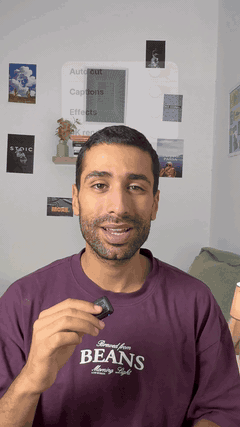<br><code>apple-toggles</code><br><sub>iPhone switches flip on</sub></td></tr>
<tr><td align="center" width="25%">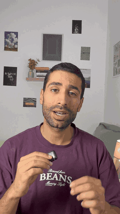<br><code>messages</code><br><sub>iMessage notifications stack up</sub></td><td align="center" width="25%">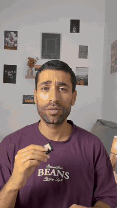<br><code>led-sign</code><br><sub>LED sign types itself behind you</sub></td><td align="center" width="25%">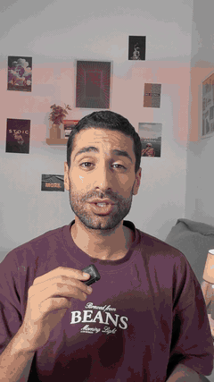<br><code>red-collage</code><br><sub>B&W you, giant red word</sub></td><td align="center" width="25%">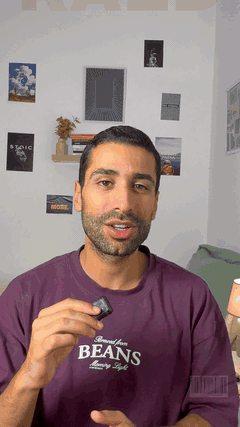<br><code>cover-star</code><br><sub>you on a magazine cover</sub></td></tr>
<tr><td align="center" width="25%">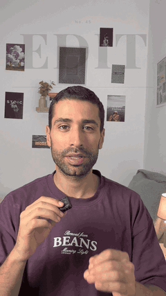<br><code>cover-star (editorial)</code><br><sub>cover-star, editorial look</sub></td><td align="center" width="25%">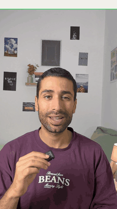<br><code>split-headline</code><br><sub>headline card pushes you down</sub></td><td align="center" width="25%">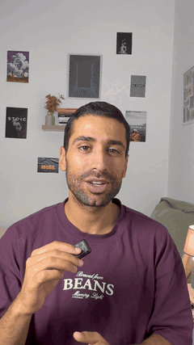<br><code>backdrop-word</code><br><sub>giant word behind you</sub></td><td align="center" width="25%">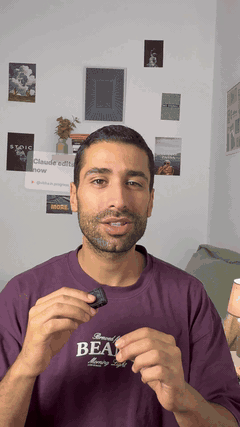<br><code>headline-wall</code><br><sub>headlines pile up behind you</sub></td></tr>
<tr><td align="center" width="25%">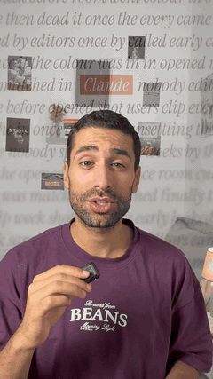<br><code>match-cut</code><br><sub>news pages cut on one word</sub></td><td align="center" width="25%">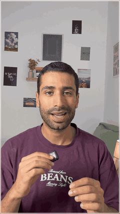<br><code>place-in-grid</code><br><sub>you in your 3x3 profile grid</sub></td><td align="center" width="25%">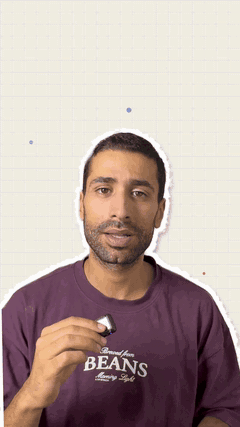<br><code>paper-cut</code><br><sub>torn-paper cut-out scrapbook</sub></td><td align="center" width="25%">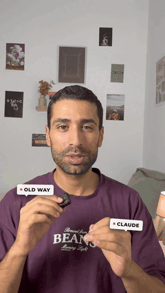<br><code>palm-tags</code><br><sub>labels ride on your hands</sub></td></tr>
<tr><td align="center" width="25%">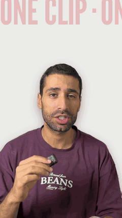<br><code>wall-of-words</code><br><sub>giant sliding words replace the room</sub></td><td align="center" width="25%">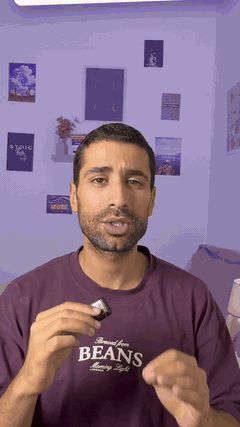<br><code>green-screen</code><br><sub>an app replaces your room</sub></td><td align="center" width="25%">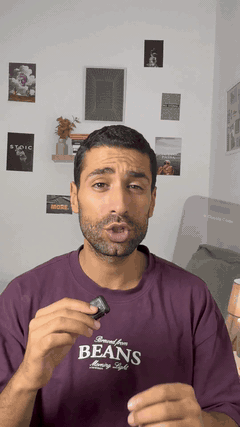<br><code>phone-mockup</code><br><sub>iPhone beside you, a tap approves</sub></td></tr>
</table>

## Install
Paste this in a terminal (or ask Claude Code to do it for you):

```bash
git clone https://github.com/ouerf-man/Ive-seen-it-all ~/.claude/skills/studio-effects
```

On Windows (PowerShell) use `$HOME\.claude\skills\studio-effects` as the folder. Then restart Claude.

## Use it
1. Open Claude Code (the app or the terminal) and drag your video in.
2. Type: `/studio-effects orbit from 3 to 6`
3. The first time, Claude sets itself up (a few minutes: ffmpeg, Node, Python). Then it checks a few frames and renders `yourclip_effects.mp4` next to your clip, with your sound.

## More coming soon
documentary · render-studio · shatter · glass type · frame break · vertigo · echo hands · UI world · zoom-through cut · the "one clip → 7 edits" reel builder,
and Claude picking the moments from what you say, captions and sound effects — coming soon in the **Creator Studio** plugin and the AI editing course.

**[Join the waitlist](#)** <!-- WAITLIST LINK: Raed adds it -->

## Honest notes
- Starter versions. It drafts, you approve: watch before you post.
- This free pack adds the effect where you say. It doesn't choose moments, write captions or add sound.

## Credits
Our studio effects: MIT (`LICENSE`). The 16 classic effects are by [@vibha.in.progress](https://github.com/Vibha-Ramprakash/claude-video-effects), also MIT. Details in `THIRD_PARTY.md`.
